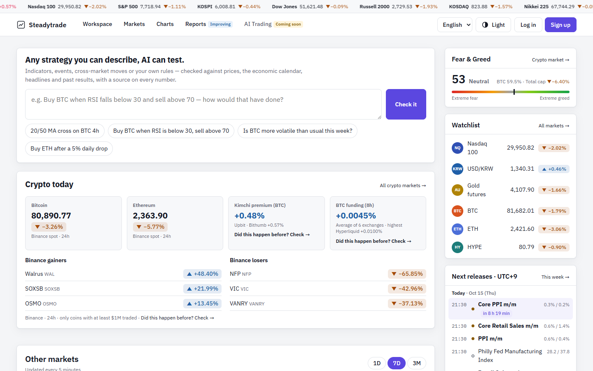
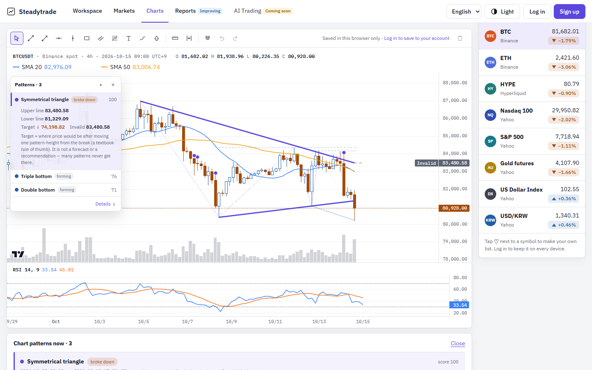
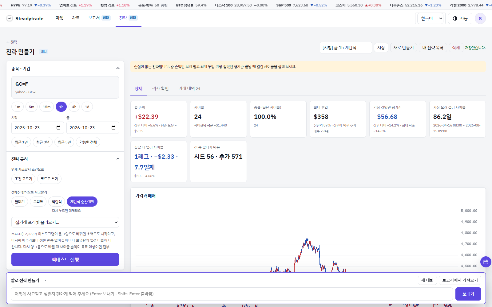
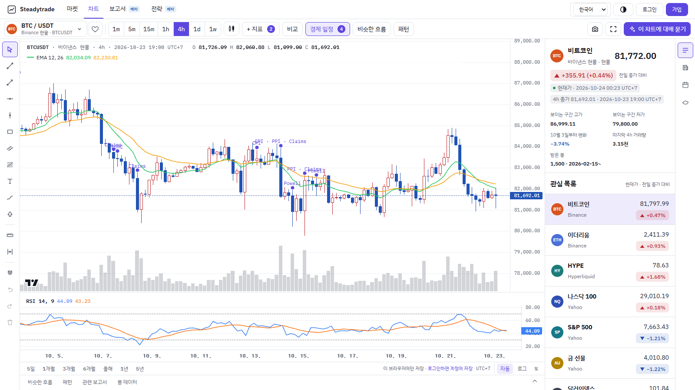
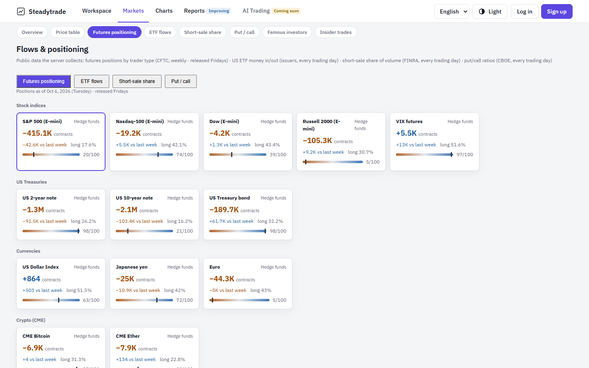
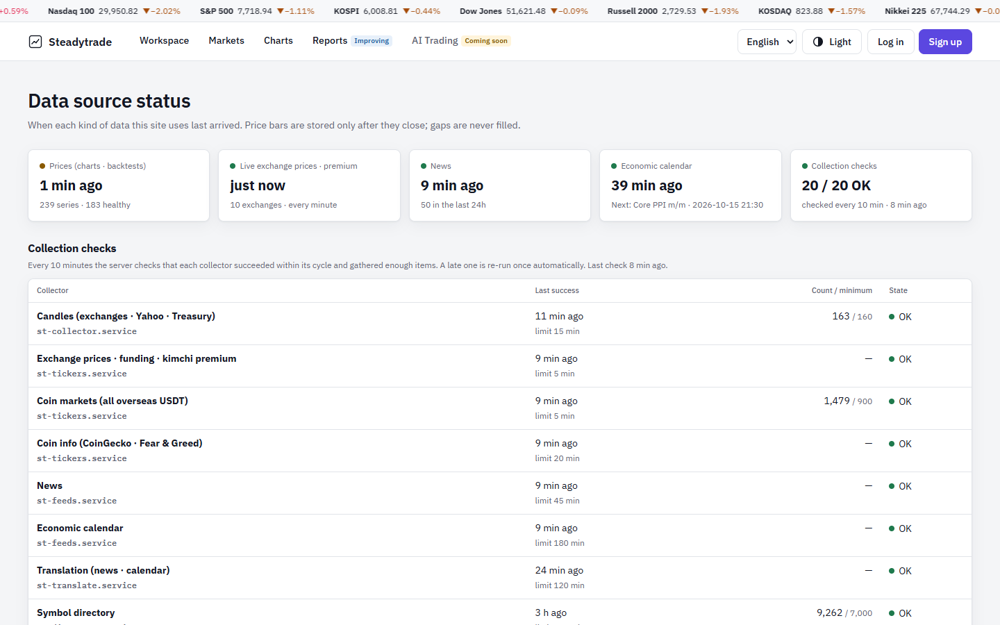

# Steadytrade 스테디트레이드

**모든 숫자에 출처가 붙는 시장 리서치.** 코인·주식·금리·거시 질문을 말로 물으면, 자료를 모아 직접 시험해 보고, 무엇을 확인했고 무엇을 확인하지 못했는지까지 적은 보고서를 씁니다.

🌐 **https://www.steadytrade.net** · [수집 현황](https://www.steadytrade.net/status) · [공개 보고서](https://www.steadytrade.net/reports?tab=public) · [English](README.md)



---

## 할 수 있는 것

| | |
|---|---|
| **AI 분석가에게 묻기** | 전략이나 궁금한 점을 말로 적습니다("ETF 가 사흘 연속 빠져나간 뒤 비트코인을 샀다면?"). AI 분석가가 데이터 도구를 불러 백테스트하고 보고서를 씁니다. |
| **전략** | 조건 고르기, 정해진 방식(물타기·그리드·적립식·계단식 순환매매), 짧은 코드, 또는 평소 말로 매매 규칙을 만들고 과거 데이터로 시험합니다. 계산은 이 저장소에 공개한 엔진으로 브라우저에서 합니다. 비공개 저장, 결과 링크 공유, 다른 사람 전략 좋아요. ([계산 방법](docs/strategy-lab.md)) |
| **보고서** | 질문을 점검표로 나눠 항목마다 *확인함 · 일부 · 확인 못 함* 을 표시합니다. 결론에는 신뢰도가 붙고, 보고서는 작성 시점 그대로 고정됩니다. |
| **마켓** | 코인(시총 상위·거래소별 상승·하락(바이낸스 기본)·김치 프리미엄·펀딩비), 큰손(하이퍼리퀴드 상위 트레이더·바이낸스 롱숏·비트코인 ETF 유출입·기업 보유량), 주식·지수, 금리·환율·원자재. |
| **수급·포지션** | CFTC 투자자별 선물 포지션, 미국 ETF 자금 유출입, FINRA 공매도 비율, CBOE 풋·콜, SEC Form 4 내부자 매매, 유명 투자자 분기 13F 변화. |
| **차트** | 거래소·야후 캔들, 지표 20여 종, 그리기, 비슷한 흐름 찾기, 규칙 기반 차트 패턴 찾기(삼각수렴·쐐기·이중/삼중 천장·바닥·헤드앤숄더). |
| **수집 현황** | 자료마다 마지막으로 언제 들어왔는지, 수집기가 모두 정상인지 공개로 보여줍니다. |

한국어·영어·일본어·중국어(간체)를 지원합니다. 브라우저 언어를 따르고, 주소 끝에 `?lang=en`·`?lang=ja`·`?lang=zh`·`?lang=ko` 를 붙이면 그 언어로 열립니다(예: [steadytrade.net/?lang=en](https://www.steadytrade.net/?lang=en)).

## 화면

| 점검표가 있는 보고서 | 차트 패턴 |
|---|---|
|  |  |

| 전략 (계단식 순환매매) | 차트 |
|---|---|
|  |  |

| 수급·포지션 | 수집 현황 |
|---|---|
|  |  |

## 원칙

- **출처가 먼저입니다.** 거래소와 공식 발표처(CFTC·SEC·FINRA·CBOE·미 재무부·ETF 운용사)에서 받습니다. [docs/data-sources.md](docs/data-sources.md)
- **마감된 봉만, 빈칸은 채우지 않습니다.** 가격 봉은 마감된 뒤에만 저장하고, 빠진 자료는 빠진 대로 보여줍니다.
- **확인 못 한 것은 확인 못 했다고 씁니다.** 질문 일부에 답하지 못하면 추측하지 않고 맨 위에 밝힙니다. [docs/reports.md](docs/reports.md)
- **공개로 점검합니다.** 수집기는 10분마다 점검하고, 늦어진 것은 한 번 자동으로 다시 돌립니다. 결과는 [수집 현황](https://www.steadytrade.net/status)에 있습니다.
- **연구용이지 투자 권유가 아닙니다.**

## 이 저장소에 공개한 코드

서비스 전체를 공개하지는 않지만, 차트와 전략 백테스트 뒤에서 도는 계산 코드는 공개합니다. 누구나 어떻게 계산하는지 확인할 수 있습니다.

| 경로 | 내용 |
|---|---|
| [`src/patterns.js`](src/patterns.js) | 사이트의 차트 패턴 찾기. AI 가 아니라 정해진 규칙으로 계산해 같은 차트는 언제나 같은 결과가 나옵니다. ([방법](docs/chart-patterns.md)) |
| [`src/indicators.js`](src/indicators.js) | 차트의 지표 엔진: 이동평균·볼린저·RSI·MACD·파라볼릭 SAR·스토캐스틱·ADX·돈치안·슈퍼트렌드·켈트너·VWAP·ATR·CCI·윌리엄스 %R·OBV·MFI·ROC 등. |
| [`src/backtest/`](src/backtest) · [`src/schema/`](src/schema) | 전략 백테스트 엔진: 다음 봉 시가 체결, 수수료·슬리피지, 펀딩, 긴 봉 필터, 규칙 형식과 검사, 계단식 순환매매. ([방법](docs/strategy-lab.md)) |
| [`src/metrics.js`](src/metrics.js) · [`src/bt-stats.js`](src/bt-stats.js) | 결과 아래 낙폭·승률 신뢰구간·거래 통계. |
| [`examples/find-patterns.mjs`](examples/find-patterns.mjs) | 바이낸스 실시간 캔들로 패턴 찾기. |
| [`test/`](test) | 실제 BTC/USDT 4시간봉으로 하는 시험 — 패턴, 백테스트 엔진(미래 데이터 안 봄·상한 안 넘음·같은 입력 같은 결과). |

```bash
# Node.js 18 이상
node --test
node examples/find-patterns.mjs XRPUSDT 4h
```

## 변경 기록

[CHANGELOG.md](CHANGELOG.md)

## 라이선스

이 저장소의 코드는 [MIT 라이선스](LICENSE)입니다. 화면 캡처와 Steadytrade 이름은 포함되지 않습니다.

---

만든 사람 초코차 · [에펨코리아 가상화폐](https://www.fmkorea.com/coin)
