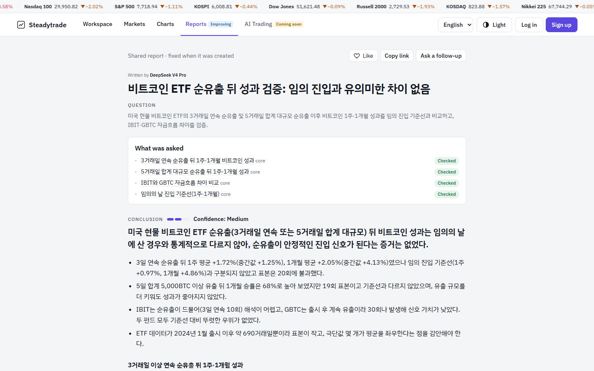

# How reports work

A report on Steadytrade answers one question with data, and is honest about the parts it could not answer.

## 1. The question becomes a checklist

Before writing, the question is split into the things that must be answered — the **core** items — plus optional extras. Example ([SR-1174](https://www.steadytrade.net/r/SR-1174)):

> How did bitcoin do 1 week and 1 month after three straight days of spot-ETF outflows, compared with buying on a random day? Does IBIT differ from GBTC?

| Item | Type |
|---|---|
| BTC 1-week / 1-month return after 3 consecutive outflow days | core |
| Same after a large 5-day cumulative outflow | core |
| IBIT vs GBTC flows | core |
| Random-entry baseline (1 week / 1 month) | core |

Each item is marked **Checked**, **Partly** or **Not checked** in the published report. If any core item is not fully checked, a banner at the top says so before the conclusion.

## 2. Data comes from tools, not memory

The AI analyst does not answer from what it remembers. It calls tools that read the collected data — candles, ETF flows, COT positions, funding rates, the economic calendar, insider filings and so on — and runs backtests and event studies on them. Numbers in the report come from those tool results. Sources are listed in [data-sources.md](data-sources.md).

When a tool has no data for something (a symbol that is not collected, a period before a series begins), the report says it was not covered rather than substituting a nearby number.

## 3. Conclusion with a confidence level

The conclusion comes first, followed by the evidence. Confidence (low / medium / high) reflects sample size and how clean the result is — e.g. *"only 20 events; not different from random entry"* is reported as such, not dressed up as a signal.

## 4. Frozen when created

A shared report is fixed at the moment it was written ("Shared report · fixed when it was created"). Later data does not silently change it; a follow-up question creates a new report. The model that wrote it is shown at the top.

## 5. Quality control

- Reports are reviewed against their own checklists; recurring gaps lead to new dedicated data tools rather than approximations.
- Early prototype reports from before the checklist format, duplicated test runs, and reports superseded by a corrected version have been removed from the public list.

Reports are research material, not investment advice.
