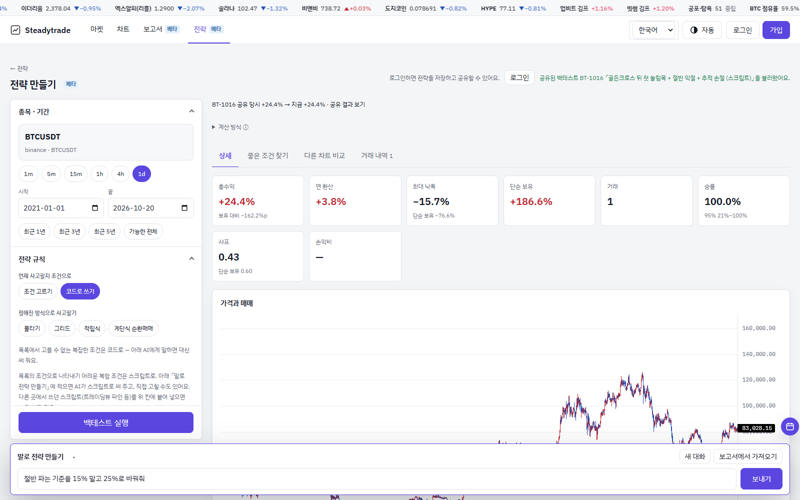
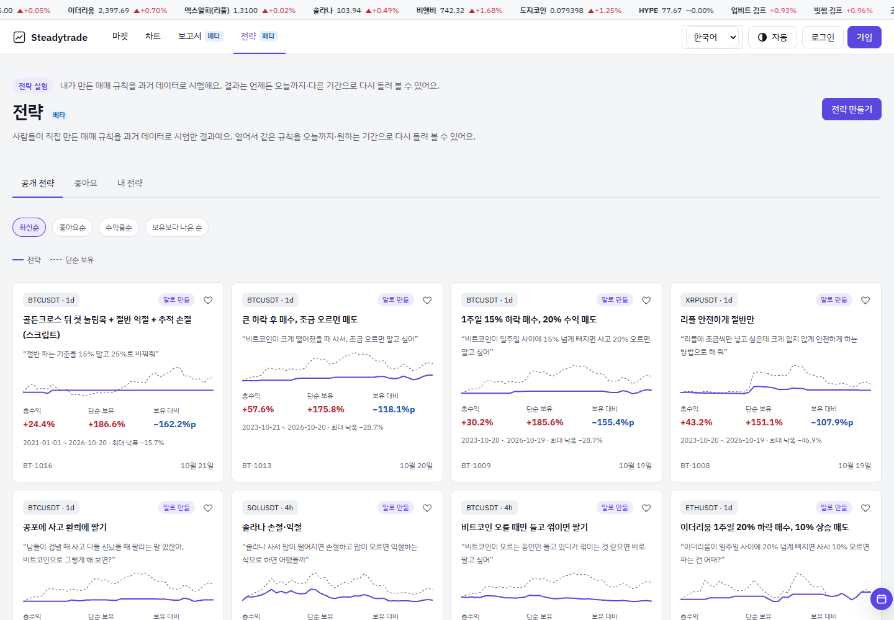

# Strategy lab — how a backtest is calculated

[steadytrade.net/strategies](https://www.steadytrade.net/strategies) lets anyone build a trading rule and test it on past prices. The calculation runs **in your browser** with the engine in [`src/backtest`](../src/backtest) and [`src/schema`](../src/schema) — the same files published here. The server only delivers candles and stores what you choose to save or share.

## Ways to build a rule

| Way | What happens |
|---|---|
| **Pick conditions** | Choose indicators and conditions from lists ("50-day average crosses above the 200-day"). |
| **Fixed methods** | Scale-in (buy more as it falls), grid, periodic buying, and the **staircase cycle** below. |
| **Write code** | A small `onBar(ctx)` script for rules the lists cannot express (partial sells, trailing stops, multi-step setups). It runs in an isolated worker and is checked for look-ahead: if a script reads a value from the future, the run is stopped and the line is shown. |
| **Describe it** | Type the idea in everyday words. An AI turns it into one of the forms above; the result is a normal rule you can read and edit — the AI does not run the backtest. |

## Rules the engine follows

- **Signal on a closed bar, fill on the next bar's open.** A signal that appears at the close of bar *i* is filled at the open of bar *i+1*. Filling at the same close would use information that was not available yet. ([test](../test/backtest.test.mjs))
- **Costs are always on.** Default 0.1% fee per side plus 0.05% slippage. Perpetual positions pay or receive the exchange's recorded funding when it is available, an approximate rate otherwise — the result says which.
- **Longer-bar indicators use only closed longer bars.** A 4h filter on a 1h strategy sees the last 4h bar that had already closed at that moment.
- **Warm-up bars.** Indicators are calculated on extra bars before the start date; no trades happen in that warm-up.
- **Candles are fetched when you press Run.** The lab asks the exchange (through the site's candle queue, cached for one minute) for exactly the bars it needs. If the period is too short for the bar size, the start date is widened and the result says so.
- **Same input, same output.** No randomness; a shared result can be re-run on the same period or up to today, and the page shows both numbers side by side ("when shared +24.4% → now +24.4%").

## Staircase cycle (계단식 순환매매)

A scale-in cycle bot's rules, replayed bar by bar ([`src/backtest/cycle.js`](../src/backtest/cycle.js)).

| Step | Rule |
|---|---|
| Seed | When the MACD(12,26,9) histogram of the strategy bar turns from negative to positive, buy the seed amount. |
| Add | While the histogram is not negative and price is `drop %` below the **last** buy, add `ratio %` of the amount **already held** (never less than the seed). An add that would push the cycle above the cap is skipped. |
| Exit | When the histogram turns negative and the whole cycle is up at least `exit %` after fees, sell everything. A new cycle can start on a later bar. |
| Longer-bar filter | Optional: no new seeds or adds while the longer bar (4h for ≤1h strategies, 1d otherwise) is falling. Exits always work. |
| Short | Every rule mirrored. |

There is **no stop loss** in this method, so the result page leads with risk, not profit: largest amount invested, deepest unrealized loss (vs the cap), the longest cycle in days, and the cycle still open at the end. A "100% win rate" over finished cycles can sit next to a large open loss — the page shows both.

Tests in [`test/backtest.test.mjs`](../test/backtest.test.mjs) check that the cap is never exceeded, every finished cycle met its target after fees, and adding future bars never changes past cycles.

## Sharing and likes

- **Save** keeps a rule private in your account ("My strategies").
- **Share** creates a link `/backtests/BT-####` with the result as computed when it was shared. Public shares appear in the strategy list; anyone can open one in the lab and re-run it.
- **Likes** collect strategies you want to come back to (Strategies › Liked), like the report likes.

## Not included

Order execution, exchange keys and alert delivery are not part of this repository.
